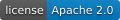

<p align="center">
  <picture>
    <source media="(prefers-color-scheme: dark)" srcset="assets/logo-dark.png">
    
  </picture>
</p>

<p align="center">
  <b>Every role. Every channel group. Its own view of depth.</b>
</p>

<p align="center">
  
  <a href="LICENSE"></a>
  
  
  
</p>

---

A residual connection hands every block one fixed sum of all the layers below it, and the query, key, value and
residual inputs of the block all read that same sum. **M3** removes the broadcast: every role, and every group of
channels within a role, reads its own token-dependent mixture of all earlier layers.

- **Drop-in.** M3 starts as an exact residual connection, so it replaces the residual connections of a pre-norm
  Transformer without touching anything else.
- **Cheap.** One small generator per block produces all mixing coefficients; a fused Triton kernel reads every earlier
  layer once, whatever the number of groups.
- **Scales.** Dense models from 100M to 1.4B parameters and sparse mixture-of-experts models up to 4.6B.

## Quick start

```bash
git clone https://github.com/Kingchet10/m3former.git && cd m3former
pip install -r dense/requirements.txt          # after installing PyTorch (see docs/TRAINING.md)

# tokenize FineWeb-Edu into the training format
python scripts/prepare_data.py --output data/fineweb-edu --tokenizer tokenizer.model --train-tokens 30e9

# train M3Former-700M on 20 tokens per parameter
python scripts/launch.py dense --size 700M --method m3-g80 --budget 20N --gpus 8 \
    --data-root data/fineweb-edu --runs-root runs
```

Swap `--method` for `transformer`, `muddformer`, `multigroup-g<G>` or `attnres-block` to train the baselines under the
same recipe. `python scripts/launch.py dense --paper` lists every run of the paper.

## M3 in your model

```python
from m3former.models import Architecture, model_config

arch = Architecture(layers=24, dim=1024, heads=16, kv_heads=16, ff_dim=2816,
                    depth_groups=16)           # G groups per role; G = 1 is MUDDFormer
model = model_config(arch).build()             # a TorchTitan Llama3 model with M3 residuals
```

The whole method is one block, [`M3Block`](dense/m3former/m3.py); the MoE version lives in
[`moe/residuals.py`](moe/residuals.py).

## What's inside

```text
dense/m3former/     M3, baselines, recipe and trainer on TorchTitan
moe/                mixture-of-experts models on Megatron Core
scripts/            data preparation, launcher, checkpoint export
evaluation/         zero- and few-shot scoring
tests/              launcher regression test and GPU checks
```

Training recipes, the MoE setup and evaluation: [docs/TRAINING.md](docs/TRAINING.md). Corpus format:
[docs/DATA.md](docs/DATA.md).

## Citation

```bibtex
@article{han2026m3former,
  title  = {M3Former: Fine-Grained Cross-Layer Mixing for Transformers},
  author = {Han, Jiasong and Chai, Yunkai and Zhu, Tong and Zhang, Hengyu and Fang, Wei and Wang, Jintao and Li, Guoqi and Cheng, Yu},
  year   = {2026}
}
```

## Acknowledgements

Built on [TorchTitan](https://github.com/pytorch/torchtitan), [Megatron Core](https://github.com/NVIDIA/Megatron-LM)
and the attention-residual kernels of [FLA](https://github.com/fla-org/flash-linear-attention). Released under the
[Apache License 2.0](LICENSE); third-party code keeps its own license ([docs/THIRD_PARTY.md](docs/THIRD_PARTY.md)).
